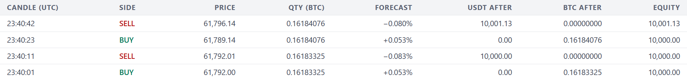
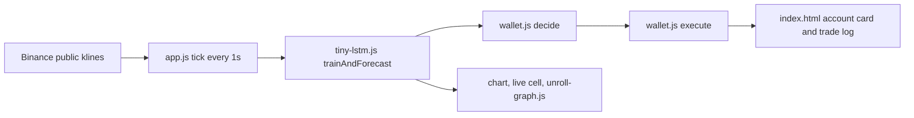
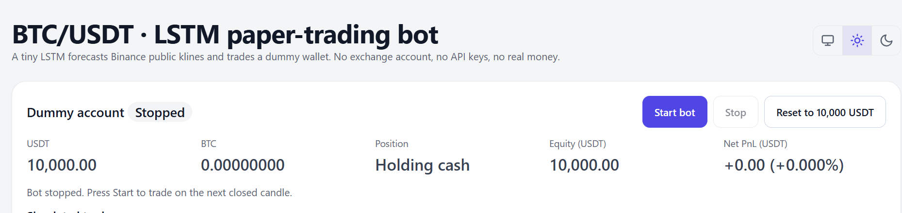
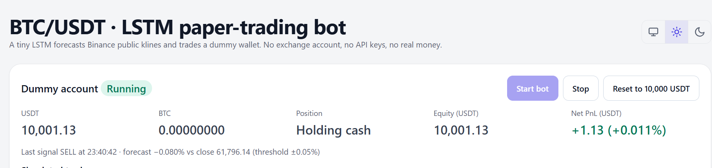
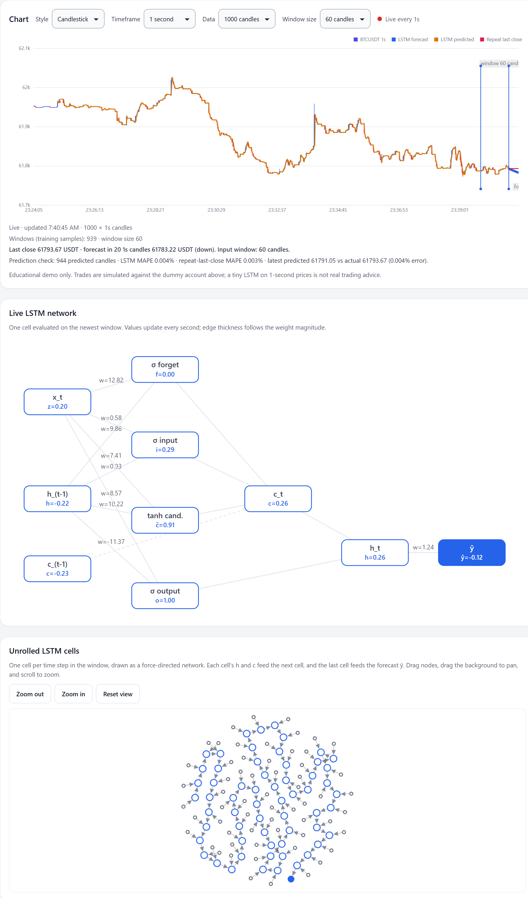

<a id="top"></a>

<h1 align="center">LSTM paper-trading bot (BTC/USDT)</h1>
<p align="center">A tiny in-browser LSTM forecasts BTC/USDT and trades a dummy wallet. No exchange account, no API keys, no real money.</p>

<p align="center">
  <a href="https://github.com/Jevoel16/BZUI-LSTM-BTCUSDT/actions/workflows/ci.yml"></a>
  
  
</p>

<p align="center"></p>

<p align="center">
  <a href="#project-overview">Overview</a> · <a href="#dummy-account-and-trading-strategy">Strategy</a> · <a href="#architecture">Architecture</a> · <a href="#how-to-run">How to run</a> · <a href="#test-results-and-screenshots">Test results</a> · <a href="#the-model">The model</a>
</p>

---

## Project overview

This is my ITD105 lab fork of [msuiit-ph/BZUI-LSTM-BTCUSDT](https://github.com/msuiit-ph/BZUI-LSTM-BTCUSDT). The reference app fetches closed BTC/USDT candles from the Binance public klines API, trains a single-cell LSTM (`tiny-lstm.js`) on normalized returns and draws a 20-candle forecast with live network graphs.

I kept that pipeline as it is and added a paper-trading layer on top:

- `wallet.js`: the in-code dummy account and the BUY/SELL/HOLD rule. Pure functions, no DOM, tested with `node:test`.
- `app.js`: after `trainAndForecast()` runs on a new closed candle, the bot compares the forecast with the last close and executes a simulated order.
- `index.html`: a "Dummy account" card (balances, equity, PnL, status, Start/Stop/Reset, trade log) in the same bzUI card style, plus a theme picker and footer.
- `theme.js`: the System / Light / Dark picker.

The only network call is the public klines endpoint, which needs no key. The wallet exists only in page memory.

## Dummy account and trading strategy

**Wallet.** `createWallet()` returns a plain object: `{ initialUsdt, usdt, btc, position, trades }`. It starts at 10,000.00 USDT and 0 BTC. `position` is one of two named states, `POSITION.CASH` or `POSITION.BTC`, so the bot can't end up holding both or neither. Equity is `usdt + btc × last close`; net PnL is equity minus the starting 10,000 USDT. Reset puts the object back to its starting values and clears the trade list.

**Signal.** Once per new closed candle, the bot computes

```
change = forecast[HORIZON - 1] / closes[closes.length - 1] - 1
```

| Condition | Signal |
| --- | --- |
| `change > +0.05%` and holding cash | BUY |
| `change < −0.05%` and holding BTC | SELL |
| anything else | HOLD |

I use the end of the 20-step forecast rather than the next candle. On 1-second candles the one-step forecast almost never moves 0.05%, so the bot would sit in HOLD forever.

**Order sizing.** All-in: BUY spends all USDT, SELL sells all BTC, both at the latest closed candle's price. There are no fees or slippage. Each trade is appended to `wallet.trades` with the candle time, side, price, quantity, forecast change and the balances after the trade.

**Bot status.** `BOT.STOPPED` or `BOT.RUNNING`. Start begins deciding on the newest closed candle; Stop freezes the wallet; Reset stops the bot and restores 10,000 USDT. Changing the timeframe keeps the wallet and retrains the model.

### Parameters used

| Parameter | Value | Where |
| --- | --- | --- |
| `SYMBOL` | BTCUSDT | `app.js` |
| `INTERVAL` | 1s (timeframe dropdown) | `index.html` |
| Candles loaded | 1000 (data dropdown) | `index.html` |
| `WINDOW` / `HORIZON` | 60 candles (window size dropdown) / 20 steps | `index.html`, `app.js` |
| `EPOCHS_PER_CANDLE` / `LR` | 30 / 0.005 | `app.js` |
| Initial balance | 10,000.00 USDT, 0 BTC | `wallet.js` (`INITIAL_USDT`) |
| Signal threshold | ±0.05% | `wallet.js` (`THRESHOLD`) |
| Trade size | 100% of the available balance | `wallet.js` (`execute`) |

## Architecture



## How to run

Prerequisites: [Node.js 26](https://nodejs.org/) (only for the local server and tests; there are no dependencies to install).

```bash
git clone https://github.com/Jevoel16/BZUI-LSTM-BTCUSDT.git
cd BZUI-LSTM-BTCUSDT
npm run dev
```

Open http://localhost:5187, keep the timeframe on 1 second, set Data to 1000 candles and Window size to 60 candles, then press **Start bot**. Trades appear in the table when the forecast passes ±0.05%. `npm test` runs the wallet and theme tests.

VS Code Live Server or any other static server works too. Opening `index.html` straight from disk doesn't, because browsers block ES modules on `file://`.

## Test results and screenshots

Test run on 2026-11-20, 1-second candles, 1000 candles loaded, window 60, all other values as in the table above.

**Screenshot 1: dummy account before and after.** The account starts at 10,000.00 USDT and 0 BTC. Within a minute of pressing Start the bot had made two round trips and was back in cash at 10,001.13 USDT, a net PnL of +1.13 USDT (+0.011%).

<table>
  <tr>
    <td width="50%" align="center"><b>Before Start</b><br><a href="screenshots/01-dummy-account-start.png"></a></td>
    <td width="50%" align="center"><b>After two round trips</b><br><a href="screenshots/01-dummy-account-after.png"></a></td>
  </tr>
</table>

**Screenshot 2: simulated trade log.** Every row was triggered by the LSTM forecast, newest first.

<p align="center"><a href="screenshots/02-trade-log.png"></a></p>

| Candle (UTC) | Side | Price | Qty (BTC) | Forecast | Equity after |
| --- | --- | --- | --- | --- | --- |
| 23:40:01 | BUY | 61,792.00 | 0.16183325 | +0.053% | 10,000.00 |
| 23:40:11 | SELL | 61,792.01 | 0.16183325 | −0.083% | 10,000.00 |
| 23:40:23 | BUY | 61,789.14 | 0.16184076 | +0.053% | 10,000.00 |
| 23:40:42 | SELL | 61,796.14 | 0.16184076 | −0.080% | 10,001.13 |

**Screenshot 3: forecast chart and network.** The blue line after the last candle is the 20-candle forecast; the orange line is each past candle's one-step prediction. Below it are the live LSTM cell (gate values and weights) and the unrolled 20-step graph for the same window.

<details>
<summary><b>Forecast chart, live cell and unrolled cells</b></summary>
<p align="center"><a href="screenshots/03-forecast-and-network.png"></a></p>
</details>

### What I saw

- **The profit is tiny.** The first round trip bought at 61,792.00 and sold 10 seconds later at 61,792.01, which is about break-even. The second bought at 61,789.14 and sold 19 seconds later at 61,796.14, a 7.00 USDT rise that is the whole +1.13 USDT gain.
- **The trades are short.** Each position was held for 10 to 19 seconds. The forecast flips sign often, and with an all-in rule each flip is a full trade.
- **The BUYs sit right on the threshold.** Both BUYs fired on a predicted move of +0.053%, just past +0.05%. The SELLs came on stronger signals (−0.080% and −0.083%).
- **The model doesn't beat the naive baseline.** The prediction check showed an LSTM MAPE of 0.004% against 0.003% for "repeat last close". On 1-second candles, prices barely move, so the model's forecast is mostly noise.
- **A real exchange would charge fees.** Binance's 0.1% spot fee on each side would have cost about 40 USDT over these four trades, which turns the +1.13 USDT into a loss.

These results are from one short run and change every time: the weights start at random values and the market moves.

## The model

[tiny-lstm.js](./tiny-lstm.js) defines `TinyLSTM`, a single-cell LSTM with scalar input and hidden state.

- Gates: forget `f`, input `i`, candidate `c̃` and output `o`, each with two weights (previous hidden state and current input) and a bias.
- Cell update: `c = f·c_prev + i·c̃`, hidden state `h = o·tanh(c)`, output `ŷ = wy·h + by`.
- Training: backpropagation through time with a squared-error loss, 30 epochs on every new closed candle.
- Input: each candle's % change from the previous close, normalized to z-scores. The forecast feeds each predicted change back in for 20 steps and converts the result back to prices.

The model has 14 parameters, far too few to forecast a market. This is an educational demo and not financial advice.

<details>
<summary><b>Project structure</b></summary>

```
index.html         page layout and styles (bzUI)
app.js             data fetch, training loop, charts, bot wiring
tiny-lstm.js       the LSTM cell and BPTT
unroll-graph.js    force-directed unrolled-cell canvas
wallet.js          dummy account and BUY/SELL/HOLD rule
theme.js           System / Light / Dark picker
scripts/serve.js   local static server on port 5187
screenshots/       test run screenshots
```

</details>

<p align="right"><a href="#top">Back to top</a></p>
